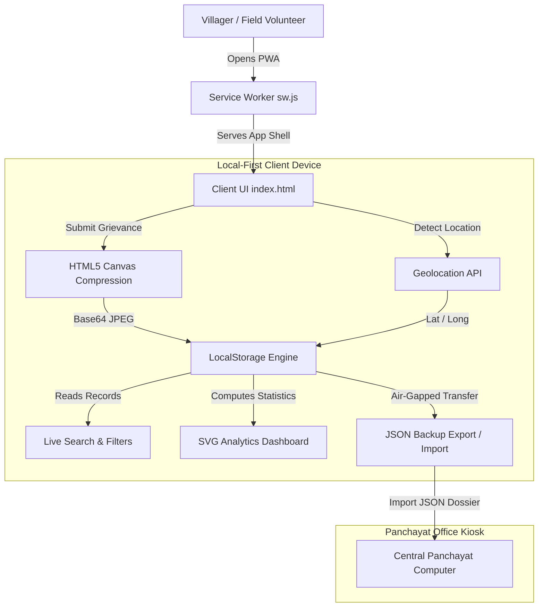

# 🌾 Gram Seva — Offline-First Rural Grievance Portal & Panchayat Analytics

[](https://developer.mozilla.org/en-US/docs/Web/Progressive_web_apps)
[](https://developer.mozilla.org/en-US/docs/Web/API/Service_Worker_API)
[](#-10-regional-indian-languages)
[](#-technology-stack)
[](LICENSE)

> **Live Application**: [https://edwinjoseph1501.github.io/Gram-seva/](https://edwinjoseph1501.github.io/Gram-seva/)  
> **Target Audience**: Rural Indian Citizens, Gram Panchayats, Village Volunteers & Common Service Centers (CSCs).

---

## 📌 Problem Statement & Motivation

In Tier-3/4 rural villages and remote habitations across India, continuous high-speed cellular connectivity cannot be guaranteed. Traditional citizen grievance portals rely on continuous cloud connectivity—causing submission failures, lost data, and citizen frustration whenever network reception drops. Furthermore, small Gram Panchayats often lack the budget or technical infrastructure to host and maintain costly cloud database servers.

**Gram Seva** is engineered specifically for this rural reality. It is a **zero-dependency, offline-first Progressive Web App (PWA)** that enables villagers and field workers to document, prioritize, and track civic issues—such as broken water pumps, faulty streetlights, road damage, and sanitation hazards—entirely on-device with GPS coordinates and photo evidence, without requiring an active internet connection.

---

## ✨ Key Features & Capabilities

### 📱 1. Installable Progressive Web App (PWA) & Offline Reliability
* **Service Worker (`sw.js`)**: Employs a versioned (`gram-seva-v1`) cache-first strategy pre-caching the entire app shell, stylesheets, icons, and logic.
* **Offline Navigation Fallback**: The app reloads and operates even in airplane mode or remote dead-zones.
* **Native Install Prompt**: Supports browser installation onto Android and iOS home screens as a standalone application.
* **Live Connectivity Badge**: Real-time accessible indicator dynamically showing `Online` or `Offline Mode` translated across all regional languages.

### 🌐 2. 10 Regional Indian Languages (100% i18n Coverage)
Empowers rural citizens in their native tongue with zero external translation API dependencies:
* 🇬🇧 **English**
* 🇮🇳 **हिन्दी (Hindi)**
* 🇮🇳 **ಕನ್ನಡ (Kannada)**
* 🇮🇳 **తెలుగు (Telugu)**
* 🇮🇳 **தமிழ் (Tamil)**
* 🇮🇳 **मराठी (Marathi)**
* 🇮🇳 **বাংলা (Bengali)**
* 🇮🇳 **ગુજરાતી (Gujarati)**
* 🇮🇳 **മലയാളം (Malayalam)**
* 🇮🇳 **ਪੰਜਾਬੀ (Punjabi)**

### 📊 3. Local Panchayat Analytics Dashboard
* **Real-Time Key Metrics**: Automatically aggregates total complaints, pending issues, in-progress workflows, and resolved grievances.
* **Pure SVG Donut Chart**: Dependency-free vector donut chart visualizing complaint status distribution with high-contrast theme-aware swatches.
* **Category Progress Breakdown**: Horizontal percentage bars tracking civic categories (`Water`, `Electricity`, `Road`, `Waste`, `Health`, `Agriculture`, `Other`).
* **Instant Dynamic Recalculation**: Recomputes metrics live upon complaint submission, lifecycle status transitions, or JSON backups.

### 🛰️ 4. Location Metadata & One-Tap GPS Capture
* **Cascading Administrative Picker**: Hierarchical selection for State / UT, District, Block / Taluk, Village Panchayat, and Ward number.
* **Geolocation API Integration**: Accurately captures latitude and longitude coordinates upon user consent with automated error handling.

### 📷 5. Client-Side Compressed Photo Evidence
* **Camera / File Upload**: Allows citizens to snap photos of broken infrastructure directly through the device camera.
* **HTML5 Canvas Compression**: Automatically resizes and compresses high-resolution camera images down to ~50KB JPEG files before storage, preventing browser memory exhaustion.

### 🔍 6. Live Search & Multi-Filter Engine
* **Instant Multi-Field Search**: Real-time filtering matching Reference IDs, complainant names, problem descriptions, and village locations.
* **Combined Status & Category Filtering**: Drill down into specific issues (e.g., *Pending Road issues in Ward 4*) with a single-click filter reset.

### 💾 7. Air-Gapped JSON Backup & Restore
* **Export Backup**: Downloads an air-gapped `.json` dossier containing complete grievance logs, metadata, and Base64 evidence photos.
* **Schema-Validated Import**: Validates imported JSON data and skips duplicate Reference IDs to allow merging records across multiple field devices.

### 🌓 8. Accessible Glassmorphic Design & Dark Mode
* **Aesthetic Visual Tokens**: Tailored rural-green palette (`#176b52`), subtle translucent panels, and standardized 24px card padding.
* **Circular Wave Transitions**: Smooth dark/light theme switching utilizing the modern browser View Transitions API with full reduced-motion accessibility.
* **Responsive 2-Column Grid**: Balanced desktop layout collapsing smoothly to a touch-friendly single-column layout on tablets and mobile phones.

---

## 🏗️ System Architecture



---

## 📂 Project Structure

```
gram-seva/
├── index.html            # Main markup (Panels, Analytics Dashboard, Modals, Install Button)
├── css/
│   └── style.css         # Design system tokens, 2-column grid, card padding & SVG chart styles
├── js/
│   └── app.js            # 10-language dictionary, PWA registration, SVG analytics & LocalStorage CRUD
├── manifest.json         # Web App Manifest for standalone mobile installation
├── sw.js                 # Service Worker (gram-seva-v1) offline caching & fetch interceptor
├── icons/                # PWA icons
│   ├── icon.svg          # Vector SVG icon
│   ├── icon-192.png      # 192x192 PNG PWA icon
│   └── icon-512.png      # 512x512 PNG PWA icon
└── README.md             # Project documentation & presentation overview
```

---

## 🛠️ Technology Stack

| Component | Technology | Rationale |
| :--- | :--- | :--- |
| **Structure** | Semantic HTML5 | High accessibility, screen-reader compatibility (`ARIA`), zero build steps |
| **Styling** | Vanilla CSS3 (Custom Properties) | Glassmorphism, CSS Grid & Flexbox, View Transitions API |
| **Logic** | Vanilla JavaScript (ES6+) | Blazing fast performance, no framework bloat, zero dependencies |
| **Storage** | Browser `localStorage` | Reliable, persistent on-device client storage |
| **Offline PWA** | Service Workers & Cache API | Immediate load time, airplane-mode reliability, home screen installability |
| **Data Viz** | Pure Inline SVG | Dependency-free vector charts rendering with crisp resolution on all screens |
| **Media Processing** | HTML5 Canvas API | High-ratio client-side JPEG compression (~50KB) |

---

## 🚀 Running the Project Locally

### Prerequisites
* Any modern web browser (Google Chrome, Microsoft Edge, Mozilla Firefox, or Safari).
* Python 3 (or any local static HTTP server).

### Steps
1. **Clone the repository**:
   ```bash
   git clone https://github.com/EdwinJoseph1501/Gram-seva.git
   cd Gram-seva
   ```

2. **Start a local HTTP server**:
   ```bash
   # Using Python 3
   python3 -m http.server 8080
   ```

3. **Open in browser**:
   Navigate to `http://localhost:8080` in your web browser.

---

## 🌐 Deploying to GitHub Pages

1. Navigate to your repository on GitHub: `https://github.com/EdwinJoseph1501/Gram-seva`
2. Click **Settings** → **Pages** (under the "Code and automation" section).
3. Under **Branch**, select `main` and set the folder to `/ (root)`.
4. Click **Save**.
5. Your live Progressive Web App will be accessible at:
   ```
   https://<your-username>.github.io/Gram-seva/
   ```

---

## 🎓 Academic / Presentation Notes

* **Why Vanilla JavaScript over React/Angular/Vue?**  
  In rural and low-cost Android smartphones (entry-level devices), large JavaScript framework bundles introduce heavy memory overhead and slow cold-starts. Pure Vanilla JS ensures the application loads under 1 second and executes efficiently on low-memory devices.
* **Why Local-First instead of a Mandatory Cloud Server?**  
  Ensures 100% operational continuity regardless of cellular infrastructure reliability. Cloud syncing can always be added as an optional layer, but the core civic utility of the portal is never hindered by network downtime.
* **Cost Efficiency:**  
  Zero server hosting fees, zero external API costs, zero database maintenance overhead.

---

## 📄 License

This project is licensed under the [MIT License](LICENSE) — free to use, modify, and distribute for civic and educational purposes.
